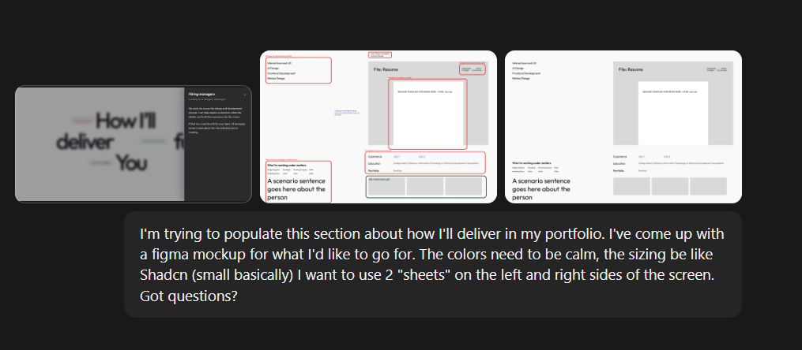
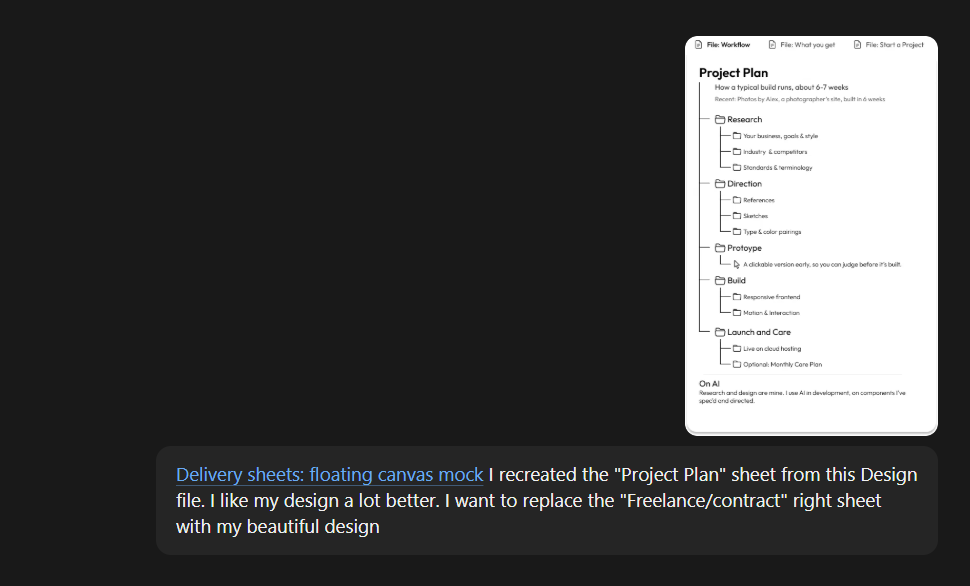

Claude conversations I used to make these changes:

1. First iteration based of Figma Wireframe (changing from shadcn-style sheet) - focused on "Hiring Managers"

https://claude.ai/share/66d8896a-c862-4f59-b7fd-260e3489b1b6 

2. Adapting changes from first iteration's conversation for "Freelance/contract" + content brainstorm

https://claude.ai/share/0d30c181-712d-4e77-8731-5ebad60b2297 

3. (Freelance/project) Project Plan redesign from Figma 

https://claude.ai/share/9a908cf9-a9e8-40ba-8a50-c524331c198e 

4. Conversation where we implement all the discussed changes

https://claude.ai/share/7159e492-8221-4604-9c8f-5d04e3d1765b 